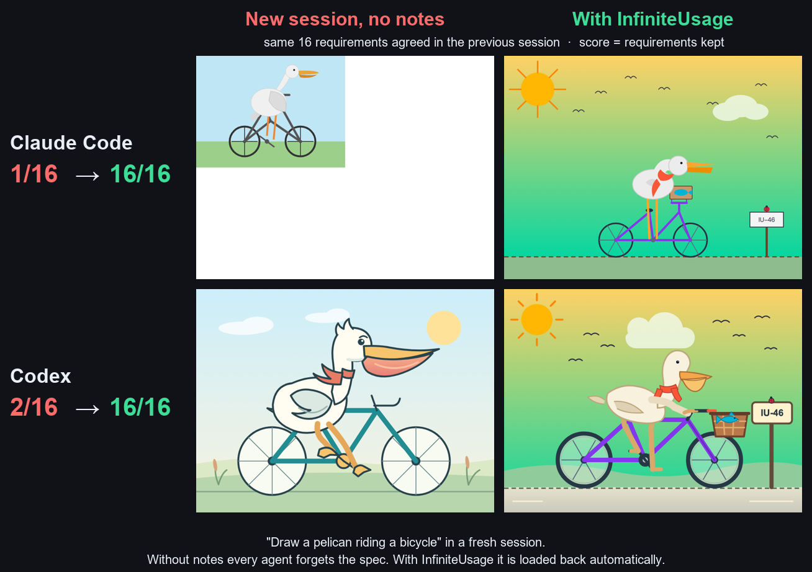

# InfiniteUsage

**One install. Your coding agent burns fewer paid tokens. Same results.**

A skill + tiny CLI (`iu`, Python standard library only) for **Claude Code and Codex**, the agents that spend your subscription. The skill also works in WorkBuddy, CodeBuddy, Cursor, Trae and every agent that reads `~/.agents/skills`; free agents such as OpenCode do the delegated work. Everything it installs was measured first, and everything that didn't measurably help was thrown out.

[中文说明](README.zh-CN.md)



## Install

Tell your agent:

> Install https://github.com/Jason-Zhang-xiquan/infiniteusage for me: clone it and run `python run_iu.py install`.

Or do it yourself:

```bash
git clone https://github.com/Jason-Zhang-xiquan/infiniteusage
python infiniteusage/run_iu.py install --dry-run
python infiniteusage/run_iu.py install
```

`--dry-run` shows every change first. Settings are backed up, and `python run_iu.py uninstall` restores them exactly. Open a new session afterwards.

## What it does, and what it measured

| | What | Measured |
|---|---|---|
| **Compact at ~300K, not ~967K** (Claude Code) | Every request re-reads the whole context. Long sessions almost never compact by default, so each turn re-reads 400–700K tokens | Replayed on 7 days of real logs: **−43% to −50%** (Codex at ~150K: −21%, −6% pessimistic). After installing, on the author's real work: **−34% tokens per request**, context −38% (before/after, not a controlled A/B) |
| **Never forget the requirements** (Claude Code, Codex) | Every requirement goes into `NOTES.md`; a hook loads it back at session start and after every compaction | Fresh session, 16 agreed details: without it **1/16**. With it: **16/16**, on both. Notes alone are not enough: Codex wrote them and still scored 1/16 until the rule or hook made it read them. Frequent compaction: 0/16 → 16/16 |
| **Free agent first** for verifiable code changes | `iu delegate` hands a self-contained change (fix tests, implement against tests) to a free coding agent (OpenCode free models; when their free quota runs out, OpenCode switches to the free API keys you added). Kept only if your check command passes, rolled back otherwise | Free agents fixed 47/48 single bugs and 3/3 four-bug sets (judged by unit tests). End to end with Opus: **−17% / −18%**, tests green, ~50 s slower. The global rule is what makes the main session use it: **−14%** vs hooks only. Free quota used up → your own key: fixed in **22 s** |
| **Fastest healthy free model** | Every call records speed and failures; stale data is re-probed in parallel in the background. Dead or rate-limited models drop to the back; a free agent that ran out of quota is abandoned at once | 6 free models probed in 2.6 s, a dead one found. A summary that timed out (30 s) came back in 4.3 s next time. Out-of-quota free agent: given up after **4 s instead of hanging 7 min** (which had cost +33%) |
| **Long output → summary** (optional) | Long test / build / git output is summarized by a free model; the raw log is saved, error lines are kept verbatim | 97% of key facts kept, 0 fabricated. **−20%** on test-heavy Sonnet tasks |

The skill and a marked block in the global instructions (`~/.claude/CLAUDE.md`, `~/.codex/AGENTS.md`) teach the agent when to use all this. With the skill alone, Opus never delegated; with the block it delegated every time.

## Tested and thrown away

Not installed, because they didn't help on measurement:

- **Switching the main model to Sonnet or Haiku**: Opus was **49% cheaper** per task (fewer turns, smaller context). Haiku as the main model cost more than Opus and failed once
- **Lowering reasoning effort**: +2% (Sonnet), +6% (Opus)
- **Compression proxies** (headroom): +2.2%
- **Code maps / memory frameworks** (claude-mem, serena-style symbol reading): the ceiling on real logs is 2–4%, smaller than run-to-run noise
- **Asking small questions somewhere else** than the long session: 0.65%
- Handoff files, output caps, masking old tool output, early compaction on short tasks (+19%: compaction costs more than it saves when sessions are short)

Numbers, scripts and caveats for every row: [EVIDENCE.md](EVIDENCE.md) (Chinese), `bench/`, `docs/`.

## Works with

| Agent | Skill | Global rule | NOTES.md auto-load | Compaction | Free-agent hook |
|---|---|---|---|---|---|
| **Claude Code** | ✅ | ✅ | ✅ hook | ✅ ~300K | ✅ |
| **Codex** | ✅ | ✅ | ✅ hook (Mac/Linux; trust it once with `/hooks`) | ✅ ~150K | — |
| WorkBuddy, CodeBuddy, Cursor, Trae, Copilot, Amp, Goose, Windsurf, Cline | ✅ | — | — | — | — |

Free coding agents (OpenCode, Kilo, Qwen Code, CodeBuddy) are the workers `iu delegate` hands code changes to. They get no global rule, so a delegated worker never loops back into `iu delegate`.

Delegation needs a free coding agent on your machine; `iu agents` lists what it finds and what you could install (it asks before installing anything). Long-output summaries need a free API (below); without one that part is simply skipped.

## Add a free API

Long-output summaries (`iu sum`, the Bash hook) run on any free OpenAI-compatible API, and `iu delegate` hands the same keys to OpenCode once its own free quota runs out. Register yourself at the provider (one account each, official free tier), then in **your own terminal**:

```bash
python run_iu.py api add gemini
```

It shows the sign-up link, asks for the key in a hidden prompt, saves it to `~/.infiniteusage/keys.env` (only you can read it) and picks a model from the provider's `/models` list. The agent never sees or types your key; `api add` refuses to run without a real terminal.

| Preset | Sign up |
|---|---|
| `gemini` | https://aistudio.google.com/apikey |
| `groq` | https://console.groq.com/keys |
| `openrouter` | https://openrouter.ai/settings/keys (`:free` models) |
| `cerebras` | https://cloud.cerebras.ai |
| `mistral` | https://console.mistral.ai/api-keys |
| `nvidia` | https://build.nvidia.com |
| `zhipu` / `siliconflow` / `dashscope` | https://open.bigmodel.cn · https://cloud.siliconflow.cn · https://bailian.console.aliyun.com |

Right after adding, `api add` runs a qualification test (usually 1–3 minutes, on that provider's free quota): 7 real command outputs scored by the same rules and bar as our model profiles (quality ≥ 85%, nothing fabricated, ≤ 30% failed calls), plus one small bug fix through OpenCode if you have it. Task types a model fails are never sent to it; a test that got no answer at all (rate limits, network) counts as inconclusive and does not block. `api list` shows the result, `api qualify gemini` re-runs it, `--no-qualify` skips it.

Any other endpoint: `api add myapi --base-url https://example.com/v1`. Then `api list`, `api test gemini`, `api remove gemini`. With several, they are tried in the order you added them. A self-hosted [FreeLLMAPI](docs/freellmapi_setup.md) gateway, if you run one, is tried first.

## Good to know

- Only the key it needs reaches a delegated OpenCode run; other keys and tokens in your environment are stripped, and briefs are scrubbed for secrets. `api add` refuses plain-http endpoints that are not on localhost
- Free models may train on what you send. Put an empty `.iu-private` file in a project to never send it out, or set `IU_NO_TRAINING_MODELS=1`
- Compaction drops details; that's why the notes exist. The real-log check after installing found no rise in user corrections right after compaction (1/52 before, 1/54 after). Small sample
- Use only legitimate free tiers: one account per provider, your own keys
- Output is in Chinese or English, following your system language; force it with `IU_LANG=en` or `IU_LANG=zh`
- Speed: delegation and summaries run free models first, so a task can take longer in wall-clock time (delegated code changes were up to ~3× slower in one test). Turn off what you don't want with `install --no-delegate`, `--no-offload`, `--no-notes` or `--no-compact`
- Free models are picked by measured speed: every real call records how long it took and whether it failed; at session start, if nothing was measured for an hour, all free APIs are probed in parallel in the background. Models that just failed go last, clearly slower ones go later, and similar ones keep the strongest-first order. A free agent that hangs no longer eats the whole delegation budget. `python run_iu.py speed` shows the table, `speed --probe` tests now, `IU_NO_SPEED_PROBE=1` turns probing off
- Codex: hooks run only after you trust them once (`/hooks` in Codex). On Windows the Codex NOTES.md hook is not installed yet (tested on Mac / Linux only); the global rule still tells Codex to read `NOTES.md`
- `python run_iu.py compare` shows your own before/after numbers

## License

MIT
